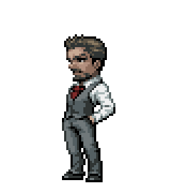

### 👨‍💻 About Me

- 💻 Full-stack development and backend APIs
- ⚙️ Exploring microservices, testing and debugging
- ☁️ Learning cloud and DevOps
- 🎯 Focused on engineering fundamentals
- 📍 Chennai, India

 

---

### 🛠️ Tech Stack

  

---

### 📊 GitHub Statistics

  
  

  

---

### 🐍 Contribution Snake

  <picture>
    <source media="(prefers-color-scheme: dark)" srcset="https://raw.githubusercontent.com/barath2k25/barath2k25/output/github-snake-dark.svg" />
    <source media="(prefers-color-scheme: light)" srcset="https://raw.githubusercontent.com/barath2k25/barath2k25/output/github-snake.svg" />
    
  </picture>

  

